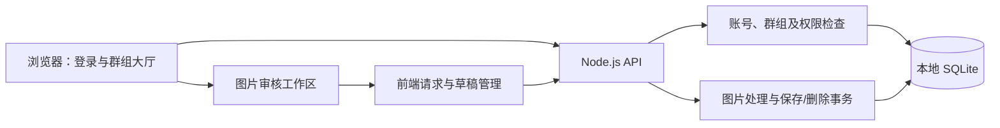

# 审图台：文件说明与可复现错误指南

更新日期：2026-10-31。以当前工作目录的实际代码为准，包括无密码账号、开放群组、图片标注、缩放、部分保存和删除功能。

本文覆盖项目自己编写的源码、配置、脚本、测试和验证材料。`node_modules` 中的第三方库、构建产物及 Git 内部文件按目录解释，不逐个展开。

## 1. 先理解项目如何运行

你在浏览器中看到的是 Vue 前端，前端通过 `/api` 请求 Node.js 后端，后端把数据保存到本机 SQLite。账号、会话、群组、图片二进制和批注都在 SQLite 中，没有远程数据库。



从零阅读建议按以下顺序：

1. `README.md`：先把项目运行起来。
2. `package.json`、`start.command`：知道每个命令实际执行什么。
3. `apps/web/src/App.vue`、`ReviewWorkspace.vue`：看登录、群组和审图界面。
4. `apps/web/src/useReview.ts`：看标注如何形成草稿、保存、处理冲突。
5. `apps/api/src/app.ts`、`service.ts`、`collaboration.ts`：看接口与业务校验。
6. `apps/api/src/database.ts`：看数据库连接和基础表结构。
7. `tests/`、`docs/verification/RESULTS.md`：看如何证明功能和失败处理正确。

## 2. 根目录与工程配置

| 文件 | 里面是什么 | 什么时候看或修改 |
| --- | --- | --- |
| [README.md](../README.md) | 面向运行者的说明：安装、启动、登录注册、群组、标注、删除、测试命令、接口约定及常见问题。 | 想知道怎么运行、怎么使用时先看它。 |
| [SUBMISSION.md](../SUBMISSION.md) | 面向评审的说明：产品规则、技术取舍、坐标与事务设计、AI协作、已知限制和后续功能。 | 准备提交作业、介绍实现思路时看。 |
| [work.md](../work.md) | 原始作业要求，包括 Vue 3＋TS、Node.js＋TS、本地 SQLite、提交方式和失败验证要求。 | 判断项目是否满足题目时对照。 |
| `审图打点项目实施方案.md` | 本地实施方案和开发规划。它是需求/方案材料，不是应用运行所需文件。 | 仅本地参考；已加入 `.gitignore` 并取消 Git 跟踪。 |
| [package.json](../package.json) | 根工程名称、Node 版本约束、npm workspaces、依赖，以及 `dev/build/start/test` 等命令。 | 增加依赖、修改统一启动或检查命令时改。 |
| [package-lock.json](../package-lock.json) | npm 生成的依赖版本、下载信息和完整性锁定记录，支持 `npm ci` 安装一致版本。 | 安装/升级依赖时由 npm 更新，不手工编辑。 |
| [.nvmrc](../.nvmrc) | 推荐 Node 主版本：24。nvm 和 CI 可以按这个文件选择运行环境。 | 更换推荐 Node 版本时改，并验证依赖兼容性。 |
| [.gitignore](../.gitignore) | 不参与版本管理的目录和文件：依赖、构建产物、数据库、测试报告、普通日志、本地实施方案等；允许提交指定验证日志。 | 防止把本地数据、依赖或方案文件提交到仓库。 |
| [start.command](../start.command) | macOS 一键启动脚本：切到项目目录、检查 Node/npm 和端口、安装缺失依赖、初始化、构建、启动生产服务。 | 双击或 `bash start.command`；调整一键启动流程时改。 |
| [vitest.config.ts](../vitest.config.ts) | 单元/集成测试配置：寻找 `tests/**/*.test.ts`，设置测试超时。 | 调整业务测试的范围和运行方式时改。 |
| [playwright.config.ts](../playwright.config.ts) | 浏览器测试配置：隔离环境校验、单 worker、测试地址、视口、生产服务启动、失败截图与 trace。 | 调整真实浏览器测试或排查浏览器失败时看。 |
| [.github/workflows/ci.yml](../.github/workflows/ci.yml) | GitHub Actions 自动检查流程：安装、类型检查、业务测试、安装 Chromium、端到端测试、重启检查；失败时上传测试报告。 | 修改远程 CI 流程时改。是否执行成功需看 GitHub 实际结果。 |

## 3. 前端：`apps/web`

前端负责显示界面、收集输入和管理当前草稿；保存是否成功由后端确认。

| 文件 | 具体内容与职责 |
| --- | --- |
| [apps/web/package.json](../apps/web/package.json) | 前端 workspace 的名称、版本和模块类型声明。主要依赖与脚本统一放在根 `package.json`。 |
| [apps/web/tsconfig.json](../apps/web/tsconfig.json) | 前端 TypeScript 配置，包括 DOM 类型、Vue 文件、共享类型路径及严格类型检查。 |
| [apps/web/vite.config.ts](../apps/web/vite.config.ts) | Vite 开发与构建配置：启用 Vue 插件，将 `/api` 代理到本机 3001 后端，前端产物输出到 `dist/web`。 |
| [apps/web/index.html](../apps/web/index.html) | 网页 HTML 入口，设置语言、标题、视口，提供 Vue 挂载容器 `#app` 并加载 `main.ts`。 |
| [apps/web/src/main.ts](../apps/web/src/main.ts) | 创建 Vue 应用、导入全局 CSS，把 `App.vue` 挂载到 `#app`。 |
| [apps/web/src/App.vue](../apps/web/src/App.vue) | 应用外壳：查询登录会话、登录/注册表单、群组大厅、搜索/创建/加入/删除群组、退出登录；进入群组后显示 `ReviewWorkspace`。也维护群组 URL 参数。 |
| [apps/web/src/ReviewWorkspace.vue](../apps/web/src/ReviewWorkspace.vue) | 图片审核界面：选图、上传/删除照片、渲染图片和圆点、说明编辑、保存提示、缩放按钮、列表定位、图片切换提示、离开草稿确认。处理 Enter 保存、Shift＋Enter 换行、Delete/⌫ 删除标记及输入法保护。 |
| [apps/web/src/useReview.ts](../apps/web/src/useReview.ts) | 草稿状态机：维护服务端快照、当前草稿、revision、选中标记、冻结的保存请求。实现新增/删除、有效项先保存、保留未完成草稿、失败重试、响应丢失后核对、冲突、切图，以及确认照片删除后的界面清理。 |
| [apps/web/src/useViewportGestures.ts](../apps/web/src/useViewportGestures.ts) | 手势缩放逻辑：普通滚轮与双指滑动保持平移，Shift＋滚轮或捏合缩放；比例限制10%—400%；使用鼠标/手势位置作为锚点。兼容 Chromium 的 ctrl+wheel 捏合事件和 Safari GestureEvent，合并高频事件并清理监听。 |
| [apps/web/src/coordinates.ts](../apps/web/src/coordinates.ts) | 坐标纯函数：`point` 把点击转换为图片内0—1比例坐标；`centerAnchor` 求视口中心对应图片位置；`clamp` 限制坐标或滚动范围。 |
| [apps/web/src/api.ts](../apps/web/src/api.ts) | 统一 HTTP 请求封装：JSON响应、HTTP业务错误、网络错误和超时区分。普通请求12秒上限，上传独立120秒上限；超时不是已确认的HTTP保存失败，因此仍能触发结果核对。 |
| [apps/web/src/style.css](../apps/web/src/style.css) | 全局视觉与布局：登录页、群组大厅、图片工作区、圆点、侧栏、编辑框、提示、弹层、删除按钮及窄屏适配。 |

**容易混淆的两处：**

- 登录和群组大厅主要在 `App.vue`；图片标注的具体交互在 `ReviewWorkspace.vue`。
- `ReviewWorkspace.vue` 负责界面事件；保存状态和草稿规则集中在 `useReview.ts`，不要各自维护另一套保存状态。

## 4. 后端：`apps/api`

后端负责最终校验、权限与持久化，不能只依赖前端禁用按钮。

| 文件 | 具体内容与职责 |
| --- | --- |
| [apps/api/package.json](../apps/api/package.json) | 后端 workspace 的模块声明。 |
| [apps/api/tsconfig.json](../apps/api/tsconfig.json) | 后端 TypeScript 配置，使用 NodeNext 模块解析，将后端及共享代码编译到根 `dist`。 |
| [apps/api/src/server.ts](../apps/api/src/server.ts) | 真正启动 HTTP 服务的入口。打开 SQLite，创建 Express app，只监听本机，检查生产前端产物，处理端口错误和退出时关闭连接。允许零照片数据库启动。 |
| [apps/api/src/app.ts](../apps/api/src/app.ts) | Express 接口装配：登录会话、群组、图片、批注和删除路由；JSON/multipart请求限制；权限检查；统一错误响应；生产静态网页托管；localhost首页规范化跳转。 |
| [apps/api/src/database.ts](../apps/api/src/database.ts) | SQLite 连接和路径定位，开启外键、WAL、busy timeout；创建核心表及索引，再调用协作功能迁移。默认库为根 `data/review.sqlite`。 |
| [apps/api/src/collaboration.ts](../apps/api/src/collaboration.ts) | 账号/群组业务和增量迁移：名字规范化、注册/登录、会话哈希与Cookie、群组创建/搜索/加入、成员校验、图片所属群组校验。创建协作相关表并迁移旧数据到默认协作组。 |
| [apps/api/src/service.ts](../apps/api/src/service.ts) | 图片元数据与批注读取、后端运行时校验、增量保存及旧整批接口兼容、正式版本归档与提交收据幂等查询。调用三方合并，检查UUID、坐标、字符数、跨图归属和revision；更新创建/修改历史；异常整体回滚。提供统一 `ApiError`。 |
| [apps/api/src/images.ts](../apps/api/src/images.ts) | 图片真实解码处理：PNG/JPEG/静态WebP校验、拒绝动画/损坏文件、输入像素限制、统一方向、移除元数据、输出大小和最终尺寸/MIME确认。 |
| [apps/api/src/seed.ts](../apps/api/src/seed.ts) | 幂等演示数据初始化：小林/小周账号、默认组成员、原创SVG图案转PNG并存入SQLite。保留已有批注；已明确删除的种子图片不会重新生成。 |
| [apps/api/src/deletions.ts](../apps/api/src/deletions.ts) | 照片和群组删除事务：检查上传者/创建者权限，照片检查revision，清理关联标记/图片/成员关系，保留账号和其他群组，保护系统默认群组，并记录种子图片删除状态。 |

### 数据表分别存什么

| 表 | 保存内容 |
| --- | --- |
| `operators` | 身份ID与显示账号名，历史批注通过ID引用作者。 |
| `accounts` | 账号名规范化后的唯一键与身份ID。 |
| `sessions` | 登录令牌哈希、身份ID和到期时间，不存明文令牌或密码。 |
| `groups` | 群组ID、唯一名字、创建者和创建时间。 |
| `group_members` | 哪个账号加入了哪个群组。 |
| `images` | 图片标题、二进制、MIME、宽高、版本、上传者和时间。 |
| `image_groups` | 图片所属群组，图片删除时归属关系级联清理。 |
| `annotations` | 标记ID、比例坐标、文字、顺序、创建人/修改人和时间。 |
| `review_drafts` | 本账号各图片/窗口的私人草稿、基准标注快照、基准revision、选中标记、备份版本、清理状态和时间。 |
| `deleted_seed_images` | 明确删除过的种子图片ID，防止初始化时复活。不是通用回收站。 |

表结构主要在 `database.ts` 和 `collaboration.ts` 中，不存在另一份需要手工执行的迁移SQL文件。

## 5. 共享代码：`packages/shared`

| 文件 | 具体内容 |
| --- | --- |
| [packages/shared/package.json](../packages/shared/package.json) | 共享 workspace 声明。 |
| [packages/shared/src/contracts.ts](../packages/shared/src/contracts.ts) | `Account`、`GroupInfo`、`ImageInfo`、`Annotation`、`Review`、`SaveBody`、`PatchBody` 等共享TypeScript类型，`annotationChanges`计算新增/修改/删除列表；`contentLength`按Unicode码点计算说明长度；`business`生成忽略服务端历史字段的规范业务快照，用于判断修改和核对保存结果。 |

TypeScript类型只在开发时提供约束，不能代替 `service.ts` 的后端运行时校验。

## 6. 启动、初始化与验证脚本：`scripts`

| 文件 | 做什么 | 对应命令 |
| --- | --- | --- |
| [scripts/setup.ts](../scripts/setup.ts) | 打开数据库，执行幂等迁移和演示数据初始化，然后关闭连接。 | `npm run db:setup` |
| [scripts/e2e.mjs](../scripts/e2e.mjs) | 浏览器测试外层启动器：创建临时目录和测试标记、分配端口和绝对DB路径，把环境传给Playwright，结束后清理。支持传入 `--grep` 等参数。 | `npm run test:e2e` |
| [scripts/reset-test.ts](../scripts/reset-test.ts) | 每个浏览器用例前重置隔离库的批注、版本、账号会话、群组和删除记录，再恢复演示图片。严格检查临时目录及测试标记，拒绝重置开发库。 | 由测试调用，不用于日常清理数据。 |
| [scripts/smoke.mjs](../scripts/smoke.mjs) | 在真实临时文件库中启动/停止生产服务，并强制终止临时测试后端，检查私人草稿、登录会话、保存后重启恢复、初始化幂等、清空和删完照片后不复活、空库可启动。 | 先构建，再 `npm run test:smoke` |
| [scripts/measure.ts](../scripts/measure.ts) | 测量8次10MiB BLOB同步插入内存SQLite的耗时。使用测量字节，不是合法业务图片，不包含磁盘I/O。 | `npm run measure` |
| [scripts/verify-clean.mjs](../scripts/verify-clean.mjs) | 临时克隆本地Git中已经提交的版本，再依次执行安装、初始化、类型检查、业务测试、构建、重启与浏览器测试，复制部分验证截图回当前项目。 | 提交代码后执行 `node scripts/verify-clean.mjs`；默认用本机Chrome。 |

注意：`verify-clean.mjs`验证的是**已提交的版本**，不会把未提交的修改自动带入临时克隆。

## 7. 自动化测试：`tests`

| 文件 | 检查什么 | 测试层次 |
| --- | --- | --- |
| [tests/api.test.ts](../tests/api.test.ts) | 请求超时与中文提示、上传独立超时上限、13秒响应不被旧12秒限制中止、HTTP与网络错误区分。通过假计时器快速模拟长时间等待。 | 前端请求单元测试。 |
| [tests/draft.test.ts](../tests/draft.test.ts) | 保存失败保留草稿、结果未知时冻结与核对、冲突不覆盖、有效标记先保存、未完成项保留、补全后使用新版本。保留内部状态机的原操作人切换校验，当前实际界面改为登录会话。 | 前端状态机单元测试，HTTP被模拟。 |
| [tests/service.test.ts](../tests/service.test.ts) | 真实SQLite事务、历史保留、清空、旧版本合并、UUID/坐标/Unicode校验、中文大请求体、真实解码上传边界及localhost规范化。 | 真实数据库/HTTP集成测试及坐标函数测试。 |
| [tests/collaboration.test.ts](../tests/collaboration.test.ts) | 无密码注册登录、名字唯一、会话失效、群组搜索/直接加入、非成员403、操作人来自会话、旧库迁移、删除权限/版本/清理/回滚及种子图不复活。 | 真实HTTP和SQLite集成测试。 |
| [tests/e2e/review.spec.ts](../tests/e2e/review.spec.ts) | 真实浏览器中的落点保存刷新、缩放滚动、500故障注入、提交后丢失响应、双页面冲突、PNG上传、滚轮/捏合、删除快捷键、部分保存和Enter换行/保存。 | 端到端测试。 |
| [tests/e2e/collaboration.spec.ts](../tests/e2e/collaboration.spec.ts) | 从真实UI注册两位账号、创建/搜索/加入群组、共同标注、保持会话、错误反馈、照片/群组删除确认与取消、失败保留、权限入口、删除响应丢失核对。 | 端到端测试。 |

不同层次证明的事情不同：模拟500可以证明前端提示与草稿保留；它本身不能证明SQLite事务回滚，回滚由真实数据库测试证明。

## 8. 文档与验证证据：`docs`

| 文件 | 内容和用途 |
| --- | --- |
| [docs/项目文件说明.md](项目文件说明.md) | 就是本文，说明文件分工、功能入口及可复现错误的含义。 |
| [docs/verification/RESULTS.md](verification/RESULTS.md) | 按日期记录实际执行命令、结果、已发现问题、修复和验证限制。后续章节可能更新前面历史状态，应结合时间阅读。 |
| [docs/verification/clean-run.log](verification/clean-run.log) | 某次干净克隆验证的原始终端输出。只代表当时被检查的提交，不代表后来所有功能都重新做过干净克隆验证。 |
| [docs/verification/save-failure.png](verification/save-failure.png) | 主动注入保存500时，页面显示失败且保留草稿的截图。 |
| [docs/verification/workspace.png](verification/workspace.png) | 图片工作区与标记/说明编辑布局的验证截图。 |
| [docs/verification/login.png](verification/login.png) | 无密码登录页面截图。 |
| [docs/verification/groups.png](verification/groups.png) | 群组大厅和创建/搜索入口截图。 |
| [docs/verification/group-review.png](verification/group-review.png) | 群组内多人共同标注、创建人及修改人显示的截图。 |

## 9. 本地生成但不提交的内容

| 路径 | 是什么 | 为什么忽略 |
| --- | --- | --- |
| `node_modules/` | npm安装的第三方依赖。 | 体积大，可按lockfile重新安装。 |
| `dist/` | 前端静态页面与编译后的后端/共享JavaScript。 | 可运行 `npm run build` 重新生成。 |
| `data/review.sqlite` | 日常运行数据库。 | 包含实际账号、会话、群组、图片和批注，不是源码。 |
| `data/review.sqlite-wal`、`data/review.sqlite-shm` | SQLite WAL模式的伴随文件，可能在服务运行时存在。 | 属于运行中数据库，不应上传。 |
| `playwright-report/` | 浏览器测试HTML报告。 | 可重新生成；CI失败时可作为artifact保留。 |
| `test-results/` | 浏览器失败截图、trace等临时产物。 | 可重新生成，关键证据另存 `docs/verification/`。 |
| 普通 `*.log`、`.DS_Store` | 临时日志、macOS目录元信息。 | 不属于项目源码；指定 `clean-run.log`作为验证例外保留。 |
| `.git/` | Git本地提交对象、索引、引用和仓库配置。 | 由Git管理，不当作项目文件手工修改；历史提交与当前文件是否被忽略是两回事。 |

### 新增的崩溃草稿保护文件

| 文件 | 内容和用途 |
| --- | --- |
| [apps/api/src/drafts.ts](../apps/api/src/drafts.ts) | 私人草稿的运行时校验、列表/读取、版本条件写入和清理。允许空说明与未完成文字，不改正式标注；按会话隔离账号并校验组员身份。清理保留版本墓碑，避免旧请求复活。 |
| [apps/web/src/useDraftBackup.ts](../apps/web/src/useDraftBackup.ts) | 自动备份调度、串行请求、窗口分支、备份状态、失败重试、恢复候选、清理及页面隐藏时尽力补发；停止输入0.5秒、持续输入最长约2秒触发。由useReview调用。 |
| [tests/backups.test.ts](../tests/backups.test.ts) | 真实HTTP/SQLite草稿隐私、格式和2MiB边界、CAS顺序、清理墓碑、跨进程文件持久化和照片/群组删除级联。 |
| [tests/e2e/backups.spec.ts](../tests/e2e/backups.spec.ts) | 异常关页恢复、备份失败重试、正式提交清理、旧版本恢复后合并保存、多窗口分支、账号隔离、删除操作草稿、持续输入、离开备份及明确放弃。 |
| [docs/verification/draft-recovery.png](verification/draft-recovery.png) | 恢复提示和备份状态的浏览器验证截图。 |

`collaboration.ts`迁移中新增review_drafts表（版本4），外键指向图片和账号；图片删除时级联清理备份。`contracts.ts`新增DraftBackup类型；`ReviewWorkspace.vue`显示备份状态与恢复入口；`useReview.ts`连接正式保存、部分保存、切换与恢复状态。草稿备份不使用浏览器持久存储保存业务内容。

### 双账号并发演示文件

| 文件 | 内容和用途 |
| --- | --- |
| [tests/e2e/concurrency.spec.ts](../tests/e2e/concurrency.spec.ts) | 两个独立登录会话读取同一版本、修改同一个标记，让两个保存请求同时放行到真实后端，检查双方200、最终revision、两个独立标记与同位置点击，并自动生成报告和截图。 |
| [docs/verification/concurrency-demo.md](verification/concurrency-demo.md) | 最近一次双账号并发演示的步骤、账号修改、实际HTTP结果、最终内容、截图与复现命令。 |
| [docs/verification/concurrency-demo.json](verification/concurrency-demo.json) | 同次演示的机器可读记录：请求版本、文字、HTTP状态、双方账号、最终版本及两条正式标记。 |
| [docs/verification/concurrency-xiaolin.png](verification/concurrency-xiaolin.png) | 演示中小林账号的真实页面截图，保存后刷新显示双方内容。 |
| [docs/verification/concurrency-xiaozhou.png](verification/concurrency-xiaozhou.png) | 演示中小周账号的真实页面截图，保存后刷新显示双方内容。 |

## 10. 按功能定位文件

| 想改什么 | 先看哪里 |
| --- | --- |
| 登录、注册、账号名字规则 | 前端 `App.vue`；后端 `collaboration.ts`。 |
| 群组创建、搜索、加入 | `App.vue`、`collaboration.ts`、`app.ts`。 |
| 上传或删除照片 | `ReviewWorkspace.vue`、`images.ts`、`deletions.ts`、`app.ts`。 |
| 删除群组及权限 | `App.vue`、`deletions.ts`。 |
| 点击落点或坐标偏移 | `ReviewWorkspace.vue`、`coordinates.ts`。 |
| 普通滚动、Shift滚轮及捏合 | `useViewportGestures.ts`。 |
| 崩溃恢复与自动备份 | `useDraftBackup.ts`、`drafts.ts`，以及 `useReview.ts` 的恢复接入。 |
| 保存、部分保存、草稿保留或冲突 | `useReview.ts`、`service.ts`；请求异常再看 `api.ts`。 |
| Enter、Shift＋Enter、Delete/⌫ | `ReviewWorkspace.vue`。 |
| 颜色、字号、布局、响应式 | `style.css`。 |
| 数据库表、迁移或演示图 | `database.ts`、`collaboration.ts`、`seed.ts`。 |
| 启动、安装、生产托管 | `start.command`、`package.json`、`server.ts`。 |

## 11. 什么叫“可复现的错误”

“可复现”是指：**其他人按照你给出的环境、输入和操作步骤，能再次观察到你描述的失败现象。**不一定每种线上偶发问题都能100%稳定触发，但必须明确触发条件和可观察结果；这个作业可以选一个稳定、主动制造的失败来验证。

只说“有时保存不了”不够，因为别人不知道用什么图片、输入什么、点哪里、看到什么。“断开保存请求后点击保存，出现失败提示且草稿保留”才有可以检查的条件。

通常一份复现说明要有：

1. **环境与前提**：代码版本、启动方式、账号/群组、是否使用隔离数据库。
2. **输入**：具体图片、说明文字、初始数据或请求参数。
3. **步骤**：逐步写清操作或给出可运行测试命令。
4. **预期行为**：正常情况下本该怎样；发生故障时应用应该怎样处理。
5. **实际现象与证据**：页面提示、HTTP状态、日志、截图或断言结果。
6. **恢复/修复后验证**：解除故障或修改代码后，如何确认功能恢复且数据没丢。

### 例子A：本项目可稳定复现的保存500失败

这个场景是**主动故障注入**，不是声称曾在真实用户保存时发生过同样的后端故障。

准备依赖后运行：

```bash
npm ci
# 使用系统已安装的 Chrome：
E2E_BROWSER_CHANNEL=chrome npm run test:e2e -- --grep '主动注入500'
```

如果没有Chrome，可安装测试Chromium后运行：

```bash
npx playwright install chromium
npm run test:e2e -- --grep '主动注入500'
```

外层脚本会自动创建隔离数据库、初始化演示数据、构建并启动测试服务；不需要手工启动日常服务。用例位于 `tests/e2e/review.spec.ts`，名称是“主动注入500：保留草稿、恢复重试后真实持久化”。

| 阶段 | 具体做什么 | 应观察到什么 |
| --- | --- | --- |
| 准备 | 自动登录演示账号，打开长图，落点输入“失败后也不能丢失”。 | 页面有一个未保存标记。 |
| 注入故障 | 只把批注PATCH保存请求拦截成HTTP 500，读取接口仍连接真实后端。 | 保存请求失败。 |
| 检查失败行为 | 点击保存。 | 显示“保存失败”和“验证用保存失败”，原说明还在，不能显示已保存。 |
| 恢复 | 移除拦截，再次保存。 | 后端确认成功，写入真实SQLite。 |
| 复验 | 刷新页面。 | 文字和标记仍然存在。 |

证据见 `docs/verification/save-failure.png` 与 `RESULTS.md`。它证明“遇到保存失败不会误报成功或丢草稿”，不证明失败分支发生了数据库回滚，因为被拦截的PATCH没有到达后端。

### 为什么制造了错误，测试最后却显示 passed？

因为用例的目标是验证：**应用遇到错误时是否正确处理。**

- 500出现了，页面如实报错，草稿保留，恢复后能保存：测试通过。
- 500出现了，页面仍显示已保存，或者文字丢失：测试失败。

所以“可复现失败”不要求你故意留下一个没修的bug，也不要求正式测试套件永远报红。

### 例子B：手工复现并发保留双方标记

1. 两个账号加入同一群组，各用独立浏览器会话打开同图同版本，图上已有一个正式标记。
2. 分别将此标记改成不同内容，先让A保存，再让B保存。
3. 预期双方保存成功，双方页面自动显示两条，无需刷新。第一份保留原ID，后一份有新ID；同位置编号并排，可分别点击查看。
4. 若缺少旧基准或合并后超过100个标记，后端仍返回409并保留草稿。这属于保护条件，可按提示复制内容、加载最新版本并整理后重试。


### 历史bug、失败场景、回归测试的区别

| 名称 | 意思 | 本项目例子 |
| --- | --- | --- |
| 真实bug | 实现行为不符合需求，需要修复。 | 之前空白第一条说明拦住后续有效标记保存；现在已修复。 |
| 可复现失败场景 | 给定条件下可以再次触发的失败；可能是故障注入，也可能是正常保护。 | 主动500、旧版本409、无权限403。 |
| 回归测试 | 修复之后反复运行，防止旧bug重新出现。 | 第一条留空、第二条有效时，第二条能够保存，第一条草稿保留。 |

历史问题与实际修复过程在 `docs/verification/RESULTS.md`。不要为了满足题目要求故意把已经修好的代码改坏。

### 写进提交说明的简短模板

```text
场景：保存接口500。
环境/版本：填写实际执行的代码版本、Node版本和日期。
触发：运行“主动注入500”浏览器用例，只拦截PATCH保存请求。
预期：提示失败，原说明保留，不显示已保存。
实际：填写真实页面提示和测试输出，附截图位置。
恢复：移除拦截后重试并刷新，标记和说明恢复。
边界：该用例证明前端故障处理；事务回滚由真实SQLite集成测试证明。
```

## 12. 实施方案的Git忽略规则

本地 `.gitignore` 增加了：

```gitignore
/审图打点项目实施方案.md
```

由于它原来已被跟踪，还执行了：

```bash
git rm --cached -- 审图打点项目实施方案.md
```

`--cached`表示只从Git索引中移除，**不是删除本地文件**。后续提交该移除和`.gitignore`后，最新仓库版本不再包含方案；普通`git add .`也不会重新添加它。

必须区分：**当前版本取消跟踪，不等于清除旧提交。**这个文件已经进入过旧提交，旧提交仍可能包含它；以后推送这些历史提交时，其中的副本也可能被上传。若要保证历史中也完全没有该文件，需要另行清理/重写Git历史，并视远程状态决定是否需要强制推送。本次没有改写历史或强制推送，也没有声称已经清除了GitHub上的历史副本。


## 并发保留新增文件（schema5）

| 文件/数据表 | 内容 |
| --- | --- |
| [apps/api/src/merge.ts](../apps/api/src/merge.ts) | 对比服务端旧基准、当前版本、本次修改的三方合并；同标记不同修改生成新ID，保留删除冲突中的修改，按服务端创建时间稳定排序。 |
| [tests/merge.test.ts](../tests/merge.test.ts) | 真实SQLite验证同标记分叉、新增合并、删除冲突、相同内容去重、幂等重试、时间递增、超限拒绝及事务回滚。 |
| `review_versions` | 每张图片每个正式revision的标记快照，供后端查找可信旧基准；不能恢复迁移前未记录的历史。 |
| `review_submissions` | 每次成功提交的用户、请求摘要和结果，用于重试去重及响应丢失后的结果核对；仅提交者能读取自己的收据。 |

`contracts.ts`新增MergeInfo与SavedSubmission，`useReview.ts`接收完整合并结果并保留未完成项。迁移、标记记录写入、快照、收据均受事务保护，照片删除会级联清理新增表。


## 增量保存补充（2026-11-01）

| 文件 | 当前内容 |
| --- | --- |
| [tests/incremental.test.ts](../tests/incremental.test.ts) | 验证100条中修改1条时其余99条不被写入；独立新增、并发分叉、修改与删除的两种到达顺序、重试幂等、批量操作回滚、非法操作拒绝及旧PUT兼容。 |
| `contracts.ts` | `AnnotationChange`、`PatchBody`定义增量协议；`annotationChanges`比较正式基准与可保存内容，输出added/updated/deleted，不发送作者等服务端历史字段。 |
| `useReview.ts` | 冻结预期完整结果供核对，只通过PATCH发送变化；未完成内容仍保留，重试复用提交ID，接收完整合并响应。 |
| `service.ts`、`app.ts` | 新增PATCH接口与patchReview校验；从可信基准应用明确操作，复用并发合并及事务；只写受影响标记，按需重排编号。旧PUT兼容保留。 |
| `tests/draft.test.ts`、`tests/e2e/review.spec.ts` | 新增100条标记只发送1条修改、删除只发送ID、未完成说明不误删的请求检查。 |

正式保存的上传为增量；响应、历史快照和私人草稿备份仍为完整集合。SQLite表结构和已有数据不需要升级。


## 实时推送补充（2026-11-01）

| 文件 | 内容 |
| --- | --- |
| [apps/api/src/realtime.ts](../apps/api/src/realtime.ts) | 当前Node进程的群组SSE连接管理、ready/change/access-lost事件、权限复查、15秒心跳、背压断开及监听清理。 |
| [apps/web/src/useGroupEvents.ts](../apps/web/src/useGroupEvents.ts) | EventSource连接、在线/离线状态、断线重连前核对账号和成员、连接就绪及重连补查、组件停止后的消息忽略与清理。 |
| [tests/realtime.test.ts](../tests/realtime.test.ts) | 真实HTTP/SSE校验登录、成员、账号一致性、群组隔离、成功事务通知、失败/私人草稿不通知、注销及权限撤销、照片增删和组删除、连接清理及停止服务关闭长连接。 |
| [tests/group-events.test.ts](../tests/group-events.test.ts) | 前端重连与销毁、旧连接消息忽略、换号/无权限停止、离线/在线切换、服务不可用重试的单元验证。 |
| [tests/e2e/realtime.spec.ts](../tests/e2e/realtime.spec.ts) | 两个独立账号无需刷新接收标记与图片变化，编辑时保留输入/旧基准并显示远端变动，修改与删除冲突保护，真实断网重连补查，以及照片删除后的草稿/切图、未确认保存时群组删除后可复制并退出。 |
| [docs/verification/realtime-editing.png](verification/realtime-editing.png) | B未保存输入和A最新共享说明同时显示的浏览器实测截图。 |

`app.ts`在正式操作成功后发通知；`useReview.ts`负责补查队列、干净页面更新、脏草稿保护和资源删除处理；`ReviewWorkspace.vue`显示连接状态、远端变动面板和失效提示。通知不持久化，重连通过读取当前数据补齐；私人草稿保持原有隔离和完整快照。

## 压力测试补充（2026-11-01）

| 文件 | 内容 |
| --- | --- |
| [scripts/load-test.mjs](../scripts/load-test.mjs) | `npm run test:load`入口；自动构建、创建合成账号/图片与临时磁盘SQLite、启动独立生产子进程，执行读取/增量写入/同标记并发/SSE补查场景，保存逐样本数据和汇总，归档测试库并清理临时服务。目标固定本机随机端口。 |
| [scripts/load-metrics.mjs](../scripts/load-metrics.mjs) | 仅由测试服务预加载，每秒通过IPC记录服务CPU、RSS、堆内存和事件循环延迟；正常启动不加载。 |
| [scripts/render-load-report.py](../scripts/render-load-report.py) | Python标准库把真实summary生成独立HTML图表及Markdown；不补造缺失测量值，区分HTTP请求、SSE样本与预期业务拒绝。 |
| [docs/verification/load-test/README.md](verification/load-test/README.md) | 正式结果、原始数据链接、运行命令、指标口径与限制。 |
| [docs/verification/load-test/latest.json](verification/load-test/latest.json) | 最近一次运行ID及其summary路径；旧目录保留。 |
| `load-test/<运行ID>/requests.csv`、`requests.jsonl` | 逐样本时间、场景、worker、请求类型、HTTP状态、耗时及字节数；也包括SSE通知/补查样本及不计入性能的预热/验证，需按字段筛选。 |
| `load-test/<运行ID>/summary.json`、`report.html`、`report.md` | 每场景吞吐、p50/p95/p99、错误率、状态分布、资源采样峰值与一致性检查；HTML可直接打开。 |
| `load-test/<运行ID>/resources.jsonl`、`server-output.txt` | 测试服务资源采样与构建/服务输出。 |
| `load-test/<运行ID>/fixture.sqlite.gz`、`database-info.json` | 合成测试库的gzip归档及表行数/尺寸/完整性结果，与日常库隔离。 |
| `load-test/<正式运行ID>/verification.json` | 本次独立复算CSV/JSONL与解压只读检查SQLite后的复核结果。 |
| `load-test/<正式运行ID>/report-preview.png`、`report-http-preview.png` | 由隔离无头Chrome生成并检查的报告顶部及HTTP表预览。 |

压测只验证已测负载，不把脚本worker、账号和SSE连接当作真实浏览器人数；极短阶段资源采样可能为空，不能推测为0。原始记录较大，按运行ID独立保存。
