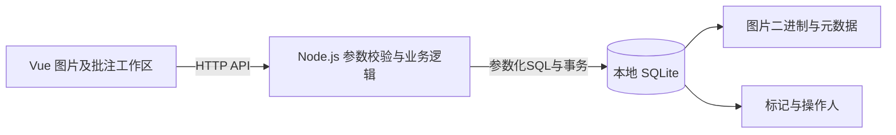

# 审图打点项目实施方案

依据：2026年10月29日读取的 work.md。项目实现状态以实际仓库为准。

本次补充：2026年10月30日，完善保存结果确认、操作归属、缩放锚点、上传边界及测试启动与隔离规则。以下测试仍须在实现后实际执行。

**建议做一个名为“审图台”的单页小工具：选图或上传图片，点击问题位置，输入说明，保存；再次打开时能恢复位置、文字和操作人。**重点做稳坐标、保存和错误恢复，再用可复现的测试体现工程能力。

按一人熟悉Vue与Node.js、约16—24小时有效开发时间安排，可分2—3天完成；不熟悉其中一端时预留4—5天。本文件是实施方案，列出的功能、脚本和测试均待实现，不能作为已经完成或验证的记录。

## 一 先确定交付范围

题面硬性要求为Vue 3＋TypeScript、Node.js＋TypeScript、本地SQLite、标点及说明保存后可恢复、缩放和滚动时位置正确、可运行仓库、SUBMISSION.md，以及至少一段能复现的失败验证。下面的数量、样式、接口和交互均为本方案主动确定的规则，应写入最终说明。

| 项目 | 建议定案 | 验收方式 |
|---|---|---|
| 图片 | 内置一张海报、一张长商详图；支持上传PNG、JPEG、静态WebP | 陌生使用者能直接试用，也能上传自己的图 |
| 图片限制 | 原始上传文件和处理后输出分别不得超过10MiB；解码图片不超过2000万像素；初版不支持动画 | 在接收、解码和入库前分别检查；超限、损坏或不支持的图片有明确提示 |
| 标记 | 单图最多100个；固定大小的带编号圆点 | 图片和右侧列表编号对应 |
| 说明 | 去掉首尾空白后1—500字符，按Unicode码点计数（即JS的`[...str].length`）；前后端采用同一规则与定义 | 空说明及超长输入不能保存，指出对应标记 |
| 修改 | 支持新增、修改文字、删除；移动点位留到后续 | 改动先成为草稿，保存后重新打开仍正确 |
| 操作人 | 下拉选择两名演示操作人，后端记录创建人和修改人 | 切换操作人能看见之前的批注；说明其不具备身份认证作用 |
| 缩放 | 适应宽度、50%、100%、200%；100%代表图片原始尺寸 | 缩放及滚动不改变标记所指的图像位置 |
| 保存 | 整张图显式保存，显示未保存、保存中、已保存、保存失败 | 仅在后端确认成功后显示已保存 |
| 冲突 | 图片版本号检查；旧版本保存返回冲突提示 | 两个页面修改同图时不会静默覆盖 |
| 范围边界 | 初版面向桌面浏览器；图片上传后不可原地替换或裁剪 | 避免旧标记对应到另一张内容不同的图片 |

时间不够时，优先保留内置图片、准确落点、说明、保存恢复及失败验证。上传和外观细节可后补，但最终SUBMISSION.md必须准确列出实际完成范围。完整账号、实时协作、画框、多边形、导出PDF和无限画布暂不进入本次范围。

**第0步：处理仓库交付。**题目要求收到后立即回复一个GitHub仓库链接，且仓库须设为公开（或保证用链接能打开）。若尚未完成，先建立公开仓库并按题目渠道回复链接；后续持续推送有意义的提交。方案本身不代表已经创建仓库或回复对方。此步骤有时效要求，是动工前第一件事。

## 二 页面怎样设计

页面采用顶部工具栏、中央图片、右侧标记列表，图片列表可作为左侧窄栏或顶部切换器。

```text
审图台   [图片选择] [上传图片]    操作人：小林    有未保存修改 [保存标注]
─────────────────────────────────────────────────────────────
[适应宽度] [50%] [100%] [200%]  点击图片上的问题位置添加标记
┌────────────────────────────────────┬──────────────────────┐
│                                    │ 标记 3 条             │
│           图片，可滚动               │ ① 价格文字看不清       │
│                 ①                  │    小林 · 10:30        │
│         ②                          │ ② 商品名称有错别字     │
│                            ③       │ ③ 活动截止日期待确认   │
│                                    │                      │
│                                    │ 选中标记的说明输入框    │
│                                    │ [删除标记]             │
└────────────────────────────────────┴──────────────────────┘
```

主流程固定为：

1. 首次打开就展示演示图、简短操作提示和操作人选择。
2. 点击图片生成标记，选中它并聚焦右侧说明输入框。
3. 输入说明后可继续添加其他标记；标记与右侧列表相互选中和高亮。
4. 点击“保存标注”；保存开始时冻结本次图片id、操作人、baseRevision及批注快照。保存期间暂时禁用编辑、重复保存、图片和操作人切换。
5. 收到后端成功确认后显示保存时间。明确的保存错误保留草稿并允许重试；超时或网络中断、无法确认是否提交时，进入“保存结果尚未确认”，先核对服务端数据，不直接重发。
6. 切图或切操作人前有未保存内容时，提供“保存后切换／放弃修改／取消”。“保存后切换”必须先以原操作人保存，成功后才切换；失败或结果未确认时停留原图片、原操作人，取消时恢复原选择。

点击现有标记只选中，不产生新标记。点击图片外留白不落点。图片加载中禁用标注。标记的点击命中区域应大于视觉圆点（建议不小于24px），保证50%缩放下仍容易点中。选中右侧列表项时，把对应标记滚到可见区域；只在用户主动选择时滚动，避免编辑输入时画面反复跳动。

## 三 技术选择和结构

| 层 | 推荐方案 | 采用理由 |
|---|---|---|
| 前端 | Vue 3、TypeScript、Vite、Composition API | 符合题目，适合单页编辑工具 |
| 后端 | Node.js、TypeScript、Express | API数量少，路由与服务层容易组织 |
| 数据库 | better-sqlite3＋本地SQLite | 参数化SQL与同步事务适合这个规模 |
| 图片处理 | sharp | 解码校验、方向规范化、取得实际保存图像的尺寸 |
| 状态 | 页面级composable | 初版一个编辑工作区即可，无需先引入全局状态框架 |
| 测试 | Vitest＋Playwright | 分别覆盖坐标纯函数、保存逻辑和真实操作流程 |
| 工程组织 | npm workspaces | 前后端和共享类型放同仓库，统一启动和检查 |

前端使用Vue官方create-vue脚手架，选择TypeScript、Vitest及Playwright。运行环境按当时脚手架要求选定受支持的Node版本，并把实际版本写入`.nvmrc`或等价文件、提交锁文件。Vue官方说明create-vue提供Vite和TypeScript配置；Vite本身转译不等于类型检查，因此需要单独的typecheck步骤。[Vue官方TypeScript指南](https://vuejs.org/guide/typescript/overview)、[Vue快速开始](https://vuejs.org/guide/quick-start.html)



为直接满足“数据只用本地SQLite”，本方案把图片二进制也存为SQLite BLOB。样例图片作为仓库内的初始化素材，运行后导入SQLite；运行期图片、批注和操作人都由本地数据库读取。数据库文件与运行产物加入`.gitignore`，通过脚本初始化。图片列表查询只取元数据，避免把所有BLOB一次载入。

开发时由Vite把`/api`代理给Node服务；生产模式确定由Node在同一端口提供构建后的前端静态资源和API，`npm start`启动后即可打开完整页面。构建产物、迁移SQL及演示素材以项目根目录或模块路径定位，不依赖启动时的工作目录；缺少必要产物时明确报错。HTTP框架采用Express的基础路由即可。[Express官方安装说明](https://expressjs.com/en/starter/installing/)

建议目录如下，名称是待创建的设计：

```text
project/
  apps/
    web/src/
      components/ImageViewport.vue
      components/AnnotationPin.vue
      components/AnnotationPanel.vue
      components/ReviewToolbar.vue
      composables/useReviewDraft.ts
      utils/coordinates.ts
      api/reviewApi.ts
      App.vue
    api/src/
      routes/images.ts
      routes/operators.ts
      services/reviewService.ts
      repositories/reviewRepository.ts
      db/migrations/001_init.sql
      db/seed.ts
      app.ts
      server.ts
  packages/shared/src/contracts.ts
  fixtures/images/
  tests/e2e/
  docs/verification/
  data/                     # 运行时数据库，不提交
  README.md
  SUBMISSION.md
  package.json
  package-lock.json
```

职责保持简单：路由负责HTTP和输入验证；service组织保存及冲突判断；repository负责SQL；前端坐标换算独立成纯函数；草稿和保存状态集中在一个composable。共享TypeScript类型不替代后端运行时校验。

## 四 核心难点是坐标

### 保存图片内的比例坐标

数据库只保存0—1之间的x和y。例如`x=0.25,y=0.60`代表图片从左向右25%、从上向下60%的位置。

图片与标记放在同一个`position: relative`容器内。容器显式宽高等于图片实际展示尺寸，图片使用`display: block`填满容器，内部不设置padding或border；装饰边框放在外层。缩放通过改变容器宽高实现，标记保持固定CSS像素大小。

点击换算示意：

```ts
const rect = imageElement.getBoundingClientRect()
if (rect.width <= 0 || rect.height <= 0) return

const x = (event.clientX - rect.left) / rect.width
const y = (event.clientY - rect.top) / rect.height

if (!Number.isFinite(x) || !Number.isFinite(y)) return
if (x < 0 || x > 1 || y < 0 || y > 1) return

// 将 { x, y } 写入当前图片草稿
```

渲染标记时：

```ts
const pinStyle = {
  left: `${annotation.x * 100}%`,
  top: `${annotation.y * 100}%`,
  transform: 'translate(-50%, -50%)',
}
```

`clientX/clientY`和`getBoundingClientRect()`都是视口坐标；后者已经反映滚动，所以这里不能再加`scrollLeft/scrollTop`。它还包含元素的边框和内边距，这也是定位区域要去掉这些装饰的原因。[MDN getBoundingClientRect](https://developer.mozilla.org/en-US/docs/Web/API/Element/getBoundingClientRect)

### 缩放定义

- 图片原始尺寸为W×H，手动缩放比例为scale，容器尺寸为W×scale、H×scale。
- 默认适应宽度：`scale = Math.min(1, availableWidth / W)`。
- 适应宽度模式下，容器宽度变化时重新计算scale；手动50%或200%模式保持用户选定比例。
- 图片与标记始终使用同一定位容器，用户通过外层`overflow: auto`区域滚动。
- 切换缩放比例时，固定使用“当前视口中心投影到图片内的比例坐标”作为锚点，投影超出图片时先夹取到图片边界；不自动使用此前选中但可能已经离屏的标记。
- 先记录旧锚点，更新图片及定位容器尺寸，等待Vue的`nextTick`及布局更新后，再按新尺寸换算`scrollLeft/scrollTop`。计算包含图片相对滚动内容的实际偏移，不能假设图片始终位于左上角。
- 将目标滚动量夹取到`0..scrollWidth-clientWidth`和`0..scrollHeight-clientHeight`；图片小于视口或靠近边界时，允许无法严格保持中心位置。验收目标为“可滚动范围内尽量保持中心图像特征”，不要求缩放前后可见内容完全相同。
- 只有用户主动点击右侧标记列表时，才滚动定位该标记。适应宽度模式下的窗口尺寸变化沿用同一锚点恢复规则。

需要特别检查：使用了含留白的`object-fit: contain`元素却把整个元素当图片区域；标记事件冒泡；图片未加载；点击外部留白；缩放后只调整图片、没有调整定位层；使用CSS transform放大却没有同步滚动布局；切换缩放比例后滚动位置未按视口锚点换算，视口跳离原区域。

### 图片上传与处理边界

上传使用`multipart/form-data`，文件字段为`image`，操作人和标题为普通表单字段。接收端独立设置单文件10MiB限制；批注保存的JSON请求体限制不用于图片上传。

处理顺序固定为：

1. 在接收文件数据时执行原始文件10MiB限制，不等文件完整读入内存后才拒绝。
2. 按真实解码格式只接受PNG、JPEG、WebP，拒绝动画或多帧输入；不能仅凭扩展名或客户端Content-Type判断。
3. 在sharp解码入口显式设置`limitInputPixels: 20_000_000`，不能先完整解码再检查像素数量。
4. 统一EXIF方向并移除其余EXIF等元数据。JPEG可使用`autoOrient()`；以实际输出图像为最终展示和标注基准。
5. 取得处理后的输出buffer及尺寸、格式信息，再检查输出字节数不超过10MiB。重新编码后可能比原文件更大，超过输出上限时在入库前返回413，并说明是处理后体积超限。
6. 最终存储的宽高和MIME来自处理后输出，与SQLite BLOB及浏览器收到的二进制一致；全部处理和校验完成后再写入数据库。

原始文件和处理后输出使用两个独立的大小检查，虽然本方案均选择10MiB上限。损坏文件、格式不支持及超限应返回明确错误；失败时不留下半条图片记录。[sharp图像操作说明](https://sharp.pixelplumbing.com/api-operation/)、[sharp构造参数](https://sharp.pixelplumbing.com/api-constructor/)、[sharp输出说明](https://sharp.pixelplumbing.com/api-output/)

## 五 数据模型和接口

### 三张表即可

| 表 | 主要字段 |
|---|---|
| operators | id、name |
| images | id、title、mime_type、image_blob、width、height、revision、created_by、created_at、updated_at |
| annotations | id、image_id、x、y、content、sort_order、created_by、updated_by、created_at、updated_at |

标记id使用稳定UUID；编号根据保存的sort_order展示。x和y使用REAL，约束为0—1；content不能为空。image_id与操作人字段建立外键。作者、时间和revision由服务端维护，不直接信任客户端提交的历史字段。

每个SQLite连接初始化时显式开启`PRAGMA foreign_keys=ON`，不依赖默认值。可启用WAL并设置合理的busy timeout。SQLite官方说明外键执行需要应用显式开启。[SQLite外键文档](https://www.sqlite.org/foreignkeys.html)

### API控制在以下范围

| 方法与路径 | 用途 |
|---|---|
| GET /api/operators | 演示操作人列表 |
| GET /api/images | 图片列表及元数据 |
| POST /api/images | 以multipart/form-data上传，分别校验原始大小、解码像素与处理后输出，再保存图片 |
| GET /api/images/:id/content | 从SQLite读取并返回图片内容，按mime_type设置Content-Type并给缓存头 |
| GET /api/images/:id/review | 返回图片信息、revision及批注集合 |
| PUT /api/images/:id/annotations | 一次保存当前图的全部批注 |
| GET /api/health | 便于启动检查 |

保存请求示例：

```json
{
  "actorId": "operator-1",
  "baseRevision": 2,
  "annotations": [
    {
      "id": "稳定的UUID",
      "x": 0.25,
      "y": 0.6,
      "content": "活动价格文字看不清",
      "sortOrder": 0
    }
  ]
}
```

保存成功返回新的revision、服务端确认的批注集合和保存时间。输入错误返回400，图片不存在返回404，版本冲突返回409，图片超限返回413，不支持的格式返回415。错误响应保持统一结构，例如`{code,message,details}`。

注意`express.json()`默认请求体上限为100KB：100个标记×500字全中文时约150KB（UTF-8每字3字节），会先于业务校验被拒绝。必须显式设置更大的上限（如512KB），并把接近上限的整图保存列为边界测试。

后端必须校验：操作人存在、图片存在、标记数量、UUID重复及归属、坐标为有限数字且在范围内、说明长度与空白。若提交的id已属于另一张图，拒绝请求，不能更新其他图片的标记。

### 保存事务与冲突处理

1. 请求进入后完成整批数据校验。
2. 在一个短SQLite事务中，以`id＋baseRevision`为条件更新图片revision。
3. 若没有匹配到行，返回409；整批批注保持原状。
4. 对本图批注进行新增、更新及删除。新增标记由服务端记录创建人、创建时间及初始修改信息；已有标记始终保留`created_by/created_at`，仅当其内容或坐标实际变化时更新`updated_by/updated_at`。未变标记保留全部历史字段。服务端按提交顺序重排`sort_order`（0..n-1）；其他标记删除引起的编号重排不算批注内容修改，不能据此把当前操作人记为整图所有标记的修改人。提交空数组是合法的整图清空操作，保存后应没有任何残留标记。
5. 所有写入成功才提交；任何异常回滚，包括revision的变更。
6. 前端收到确认后更新服务器快照并清除dirty状态。

图片处理和网络等待放在事务外。better-sqlite3的事务包装函数会在异常时回滚，其事务回调不应写成async函数。[better-sqlite3事务说明](https://github.com/WiseLibs/better-sqlite3/blob/master/docs/api.md)

图片入库前已经执行处理后输出10MiB上限检查，但BLOB写入仍为同步操作，可能阻塞事件循环。本方案面向本地、轻量低并发使用；实际耗时应测量后记录到SUBMISSION的已知限制，不预先保证阻塞仅持续某个很短时间。

冲突时保留本地草稿，提示“这张图已被其他人修改”。允许先复制本地说明，再明确选择加载最新版本；初版不承诺自动合并。

### 保存超时与结果确认

保存开始时深拷贝并固定本次提交上下文：`imageId、actorId、baseRevision、annotations`。服务端快照、可编辑草稿和本次提交快照不能共享同一可变对象。网络超时或连接中断不等于数据库未写入，先保留草稿并重新读取该图的批注及revision：

- **服务端业务内容与本次提交快照一致：**确认当前内容已持久化，采用服务端返回的快照和revision；业务比较包含标记id、坐标、规范化后的说明与顺序，忽略服务端时间等历史字段。
- **内容不同，但revision仍等于原baseRevision：**可携带原版本号、原操作人及相同提交快照重试。若旧请求仍在处理，revision条件保证最多一个写入成功；重试遇到409时再次核对，不强行覆盖。
- **revision已变化，且内容与提交快照不同：**进入冲突状态，保留本地草稿，由用户明确选择后续操作。
- **重新读取仍然失败：**维持“保存结果尚未确认”，保留所有内容，允许再次查询确认结果，不清空草稿。

不得仅把`baseRevision`升级到最新值后自动重发旧整图草稿。结果未确认期间暂时禁用编辑、直接再次保存、图片及操作人切换，以保持提交快照和页面内容一致；重新查询成功后按以上分支恢复。明确收到业务校验错误或确定回滚的错误时，仍可按普通失败处理，保留草稿并修正或重试。

## 六 前端状态怎样控制

`useReviewDraft`集中管理：当前图片id、serverSnapshot、draftAnnotations、baseRevision、selectedAnnotationId、actorId、pendingSwitch、lastSaveAttempt和saveStatus。lastSaveAttempt保存冻结的提交上下文；pendingSwitch保存待切换的图片或操作人，不提前改变当前操作归属。

| 状态 | 界面行为 |
|---|---|
| clean | 显示已保存或无修改，保存按钮禁用 |
| dirty | 显示有未保存修改，校验通过后允许保存 |
| saving | 显示保存中，暂时禁用编辑、重复请求、图片及操作人切换 |
| error | 显示明确错误原因，保留草稿，允许修正或重试 |
| unconfirmed | 显示保存结果尚未确认，保留草稿并允许重新查询；按第五章确认后再恢复编辑或保存 |
| conflict | 显示版本冲突，保留草稿并要求明确处理，禁止自动换版本覆盖 |

草稿留在当前页面内存中，业务持久化统一进入SQLite。刷新、关闭前可以添加未保存提醒，但不能把它当成可靠的自动保存机制。后续若增加草稿自动恢复，也应设计到SQLite中，而不是用浏览器本地存储替代题目要求的保存。

## 七 分阶段实施与完成标准

| 阶段 | 预计投入 | 本阶段完成什么 | 通过后再进入下一阶段 |
|---|---:|---|---|
| 0 仓库与环境 | 0.5—1小时 | 建仓库、回复链接、初始化前后端和统一启动命令 | 前端打开，健康检查成功 |
| 1 坐标原型 | 2—3小时 | 一张本地图、落点、说明、缩放、滚动、选择标记 | 同一图像特征在50%和200%下点位对应 |
| 2 持久化闭环 | 3—4小时 | 表结构、种子数据、读取与事务保存、revision检查 | 标完保存，刷新及重启服务后仍可恢复 |
| 3 完整操作 | 3—4小时 | 多图切换、编辑删除、操作人、上传、加载与失败反馈 | 陌生使用者无需口头指导完成一次标注 |
| 4 验证与修复 | 4—6小时 | 自动测试、保存失败复现、冲突和边界检查 | 核心测试通过，失败场景有可复现证据 |
| 5 交付整理 | 2—3小时 | README、SUBMISSION、演示步骤、全新克隆检查 | 按文档可独立启动并复现说明中的测试 |

建议第1天完成阶段0—2，第2天完成阶段3—4，第3天完成修复和交付。不建议先花整天设计视觉细节；阶段2结束时就应已有可保存、可恢复的完整链路。

建议提交节点为：工程骨架、图片与坐标、SQLite保存、编辑与错误处理、自动测试、交付说明。每次提交围绕一个可检查的结果。

## 八 必须执行的测试

| 测试 | 操作或输入 | 期望结果 |
|---|---|---|
| 坐标稳定 | 网格图指定位置落点，保存，50%／200%切换、横纵滚动、改变窗口宽度；包含图片小于视口和靠近边界的情况 | 标记中心仍对准同一图像特征，屏幕误差不超过2 CSS像素；可滚动范围内尽量保持中心特征，边界处允许滚动量夹取 |
| 恢复 | 保存后刷新、切图返回、重启后端 | 标记数、文字、位置和创建人正确 |
| 点击边界 | 点击已有标记、外部留白；取消未完成的新建 | 不产生额外标记，选中状态正确 |
| 输入校验 | 空说明、501字符、x=1.2、x为字符串、重复id | 拒绝保存且数据库保持原状 |
| 请求体边界 | 100个标记×500字全中文的整图保存 | 保存成功；express.json上限已显式调大，不出现413 |
| 图片归属 | 两张同名不同内容的图片分别标注 | 通过图片id区分，标记不串图 |
| 保存失败 | 仅将保存请求模拟为500 | 显示失败，草稿保留，不能显示已保存 |
| 重试 | 恢复保存接口，再点击保存并刷新 | 保存成功且不产生重复标记 |
| 冲突 | A、B同时打开同一revision；A保存后B保存 | B得到409，A数据不被覆盖，B草稿保留 |
| 已提交但响应丢失 | 让真实PUT到达后端并提交，再模拟客户端收不到成功响应 | 先进入结果未确认，重读后确认当前内容已保存，不重复写入，也不把自己的已保存内容误判为他人冲突 |
| 超时后他人已修改 | 本次响应丢失后，另一页面保存不同内容，再触发本地结果核对 | 进入冲突并保留草稿，不自动采用新revision重发旧快照 |
| 事务中途异常 | 在服务或repository集成测试中，让revision及首条批注已执行写入后抛出测试异常 | revision、批注及历史字段全部恢复到事务前状态；查询真实SQLite确认没有部分写入 |
| 修改人记录 | 操作人B只修改已有标记中的一条；另测删除造成的编号重排 | 只有实际改动的标记更新修改人和时间，其他标记保留历史信息 |
| 保存后切操作人 | 操作人A有草稿，选择保存后切到B；分别让保存成功、失败及结果未确认 | 请求使用A的身份；仅成功后切到B，其他情况仍停留A且草稿保留 |
| 删除最后一个标记 | 删除全部标记并提交空数组，再刷新及重启服务 | 保存成功，数据库和页面均为零条，无残留 |
| 上传 | 正常图、原始大小超限、处理后输出超限、像素超限、动画、伪装扩展名及损坏图 | 正常图的宽高、MIME和显示方向一致；其他输入明确拒绝且无半条图片记录 |
| 新环境 | 全新克隆，使用隔离的本地数据库启动 | 按README完成初始化和核心流程 |

单元测试重点覆盖坐标正反换算、输入验证；服务或repository集成测试使用真实SQLite覆盖事务回滚。端到端测试重点覆盖“落点→保存→刷新”“保存失败→保留→重试”及“已提交但响应丢失→核对恢复”。UI测试等待明确可观察状态，不依赖固定sleep；Playwright提供可重试断言。[Playwright断言说明](https://playwright.dev/docs/test-assertions)

### e2e启动与数据隔离

- 根目录`test:e2e`先运行外层测试启动器，由它创建本次测试临时目录、测试标记、绝对`DB_FILE`路径和独立端口，再把同一组环境变量传给Playwright进程。`beforeEach`重置脚本和后端服务继承这组配置，不能指望子进程创建的环境变量自动传回父进程。
- Playwright的`webServer.command`固定调用专用的`npm run e2e:serve`。该脚本使用传入的测试路径，依次执行“迁移＋演示数据初始化→生产构建→启动Node服务”，任何一步失败立即停止；不能自行改用默认开发库或另建一个不同的测试库。测试生产构建和正式静态托管逻辑，不依赖手动运行的Vite或API进程。
- `webServer`以测试服务的`/api/health`为就绪检查，设置`reuseExistingServer: false`，端口占用时明确失败，避免误连到开发服务。构建较慢时显式设置足够的启动timeout。
- 首版设置`workers: 1`、`fullyParallel: false`。每个用例开始前，由测试专用重置脚本恢复演示图片的批注和revision；普通`db:setup`保持幂等、不清空已有批注。冲突用例在同一个测试内打开两个页面，不依赖并行测试制造冲突。
- 重置脚本只接受本次测试临时目录内的数据库，遇到开发库路径或缺少测试标记时拒绝执行。测试启动器统一负责清理：先停止测试服务，关闭SQLite连接并等待相关子进程退出，再删除临时目录及WAL、SHM等伴随文件；不能仅等HTTP请求结束就删除仍在使用的数据库。

以上是待实现的脚本和配置约定，不代表已经具备测试环境。[Playwright webServer说明](https://playwright.dev/docs/test-webserver)

## 九 怎样留下题目要求的失败痕迹

优先选择稳定可演示的“保存请求失败”。该案例是主动故障注入，说明中应明确这一点；若实际开发发现过坐标偏移，也可以另保留真实缺陷及修复记录。

建议实现一个Playwright用例，仅拦截PUT保存请求返回500，其他读取请求仍访问真实后端：

```ts
await page.route('**/api/images/*/annotations', async (route) => {
  if (route.request().method() === 'PUT') {
    await route.fulfill({
      status: 500,
      contentType: 'application/json',
      body: JSON.stringify({
        code: 'SIMULATED_SAVE_FAILURE',
        message: '验证用保存失败',
      }),
    })
  } else {
    await route.continue()
  }
})
```

随后在测试中新增标记、输入说明、保存，检查错误提示和草稿；移除该路由拦截，再次保存并刷新，验证数据已经进入真实SQLite。不要把整个读取接口也一直mock掉，否则无法证明持久化。Playwright支持以route.fulfill控制响应状态和内容。[Playwright Route文档](https://playwright.dev/docs/api/class-route)

这段主动注入500的用例证明前端失败反馈、草稿保留和恢复重试，不证明SQLite事务已经发生回滚，因为失败分支的PUT并未到达真实后端。事务回滚使用第八章的真实数据库集成测试另行验证。“已提交但响应丢失”也需确保真实PUT已经提交后再模拟响应丢失，不能用提交前的500拦截代替。

运行后将实际命令、环境、日期、关键输出和必要截图放入`docs/verification/`。SUBMISSION写清：触发方式、预期失败现象、实际结果、如何恢复及复验。测试本身可以通过，因为它验证的是“应用遇到失败时行为正确”；不必让正式测试套件永久报错。

**不要提前写“已验证通过”。**先运行，再把真实结果填入说明。没有真的发生过的旧bug，不应编成开发经历。

## 十 统一启动和交付文档

根目录应实现以下脚本约定，下面是完成项目后希望评审能够执行的流程，当前尚未创建这些脚本：

```bash
npm ci
npm run db:setup
npm run dev
```

`npm run dev`需并发启动Vite和Node API两个进程（如使用concurrently），并分别输出日志。`npm start`使用与e2e相同的生产入口，由Node同端口提供前端静态资源和API；入口能正确找到构建产物、迁移SQL和演示素材。

验证和生产运行约定：

```bash
npm run typecheck
npm run test
npm run test:e2e
npm run build
npm start
```

README注明首次安装Playwright浏览器所需步骤。`db:setup`应用迁移并幂等导入演示素材，重复执行不清空已有批注。`test:e2e`必须能自行完成测试专用库的创建、迁移、导入和生产服务启动；`e2e:serve`及测试重置流程遵循第八章的数据库路径和隔离限制。普通启动与测试入口分别说明端口、数据库路径及环境变量，安装、检查和测试命令均需在全新克隆中实测。

README面向运行者：项目用途、环境、启动、演示步骤、常见故障。SUBMISSION面向评审，建议包含：

1. 实际完成范围与自行确定的产品规则。
2. 一分钟启动与三分钟演示路径。
3. 坐标模型、数据表、事务与版本冲突设计。
4. 为什么选择这些方案，放弃了哪些复杂功能及原因。
5. 已执行的测试和结果，链接到验证文件。
6. 可复现失败案例及恢复方式。
7. 与AI协作的实际记录：工具、任务、采纳或调整、本人检查及验证。
8. 已知限制和下一步。

三分钟演示建议：选择长图→落两个点并写说明→放大滚动→保存刷新→修改或删除一个点再保存→演示保存失败时内容保留→恢复后重试。开始演示时使用可复位的演示数据库，避免与测试或个人数据混在一起。

## 十一 怎样使用AI协作

按阶段给AI明确的小任务，自己检查设计与运行结果。例如：

- 坐标阶段：请评审归一化坐标在缩放、滚动及图片留白下是否正确，并列出可验证的反例。
- 数据阶段：请检查整图保存事务是否可能产生部分写入、跨图片修改或旧版本覆盖。
- 测试阶段：请把保存请求500、草稿保留、恢复重试设计成端到端测试，并说明哪些请求应访问真实后端。
- 交付阶段：请从第一次克隆仓库的使用者视角检查README和SUBMISSION是否缺步骤。

把实际有价值的对话与决策简要记录为“AI建议→本人决定→验证结果”。例如本次已经完成的是需求梳理和方案评审；只有之后真的实施并运行测试，才能补写实现和验证结果。

## 十二 最终提交核对

- [ ] 仓库已设为公开、链接可访问，代码已推送。
- [ ] 技术栈符合Vue 3＋TS、Node.js＋TS、本地SQLite。
- [ ] 陌生使用者能独立完成标注、保存和重新打开。
- [ ] 缩放、滚动、窗口变化后标记位置正确。
- [ ] 保存失败有反馈，草稿保留，恢复后能重试；超时先核对结果，不自动换新版本覆盖。
- [ ] 已提交但响应丢失、事务中途异常和删除最后一个标记的用例均已执行并记录。
- [ ] 保存和冲突检查在事务中完成，重启后数据仍存在。
- [ ] 未变标记保留修改历史，保存后切操作人使用原操作人完成提交。
- [ ] 缩放使用视口中心锚点，布局更新后恢复滚动，边界情况正确夹取。
- [ ] 上传原始大小、解码像素和处理后输出分别限制，最终MIME及尺寸与存储二进制一致。
- [ ] 至少一个失败场景已经实际运行，并有可复现步骤或测试。
- [ ] 新克隆按说明可以安装、初始化、启动和运行测试；e2e自行初始化独立库且不复用开发服务。
- [ ] 各e2e用例间恢复测试数据，重置脚本不会接触开发库，生产入口可直接打开完整页面。
- [ ] SUBMISSION写的是实际完成内容、真实AI协作和真实验证结果。
